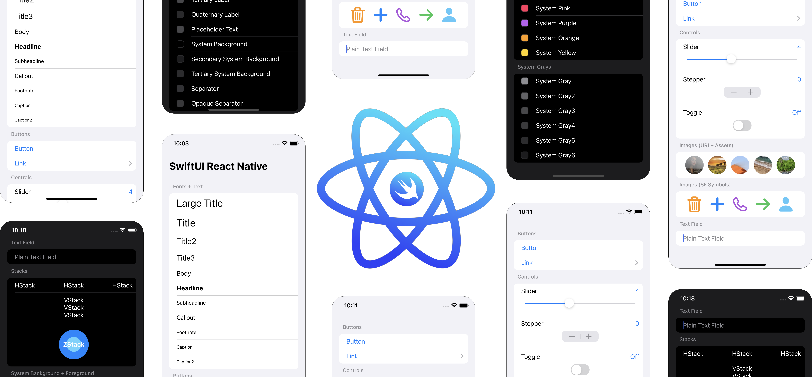

[](https://www.buymeacoffee.com/hugemathguy)

# SwiftUI React Native



Real SwiftUI views in your React Native app.

```tsx
import { Text, VStack, compose } from 'swiftui-react-native';

export function Greeting() {
  return (
    <VStack spacing={8}>
      <Text modifiers={compose().font('title').bold()}>Hello</Text>
      <Text modifiers={compose().foregroundStyle('secondary')}>From SwiftUI</Text>
    </VStack>
  );
}
```

## Requirements

iOS, the New Architecture, React Native 0.80 or newer, and `react-native-nitro-modules`.

## Installation

```sh
npm install swiftui-react-native react-native-nitro-modules
cd ios && pod install
```

With Expo, run `npx expo prebuild -p ios` instead of `pod install`. Expo Go is not supported: use a
development build.

## Generated code

Most of this library is generated from the SwiftUI in Apple's SDK, which is why it covers so much of
it. Generated files start with `Generated by swiftui-react-native. Do not edit.` and live in:

- `runtime/apple/Generated/`
- `runtime/cpp/generated/`
- `runtime/react-native/generated/`
- `runtime/react-native/specs/generated/`

The generator is not part of this repository, so edits to those files are overwritten by the next
release. If a generated API is wrong or missing, please open an issue. Pull requests to the
hand-written runtime and the example app are welcome.

## Example app

```sh
corepack yarn install
corepack yarn example:prebuild   # Once, or whenever native config changes
corepack yarn ios                # Builds and opens the app in the simulator
```

After the first build, `corepack yarn start` brings Metro back up unless you change native code.

## License

MIT
